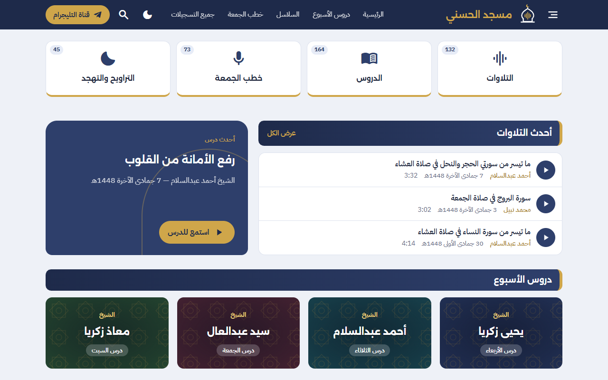
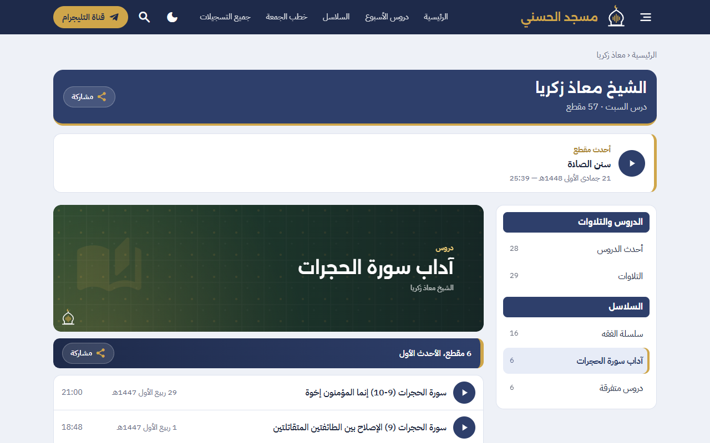
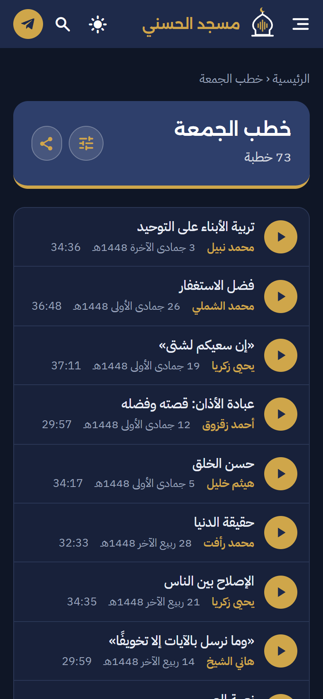
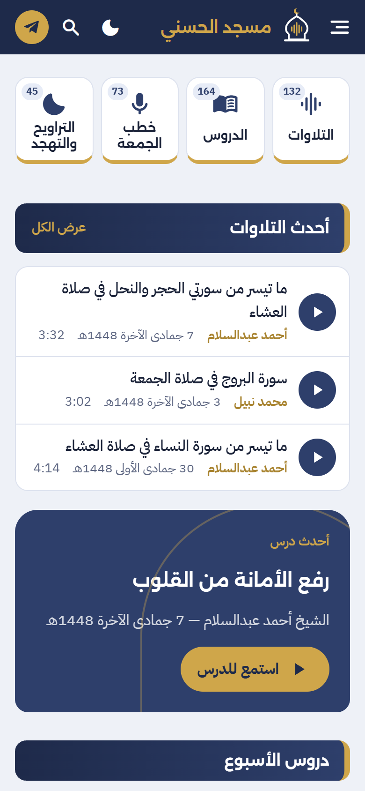

# Mosque Media

A free, self-hosted website for your mosque's **lessons, Friday sermons and Quran recitations**, built automatically from your public **Telegram channel**.

Visitors browse by sheikh → series → lesson and listen right on the site, with no Telegram needed. It costs nothing to run: the site is hosted on **Vercel** and the audio is stored in **GitHub Releases**.

<p align="center">
  
  
</p>
<p align="center"><sub>Live example: <a href="https://masjed-alhasany.vercel.app">masjed-alhasany.vercel.app</a>, the site this project grew out of.</sub></p>

---

## 🤖 Set it up with AI (recommended)

You don't need to be a programmer. Give this repository to an AI coding assistant that runs on your computer, such as [Claude Code](https://claude.com/claude-code), and it will handle the setup while you answer questions and approve each step.

Open the assistant in an empty folder and paste:

```text
Set up a website for my mosque using https://github.com/buggYateer/mosque-media
Clone it, read AGENTS.md, and walk me through the setup step by step.
Ask me about the look I want, and ask before anything that publishes or uploads.
```

Or in Arabic:

```text
عايز أعمل موقع لمسجدي من https://github.com/buggYateer/mosque-media
نزّله واقرأ AGENTS.md وامشي معايا خطوة خطوة. اسألني عن الشكل اللي عايزه، واستأذني قبل أي رفع أو نشر.
```

The assistant follows [AGENTS.md](AGENTS.md). It checks your tools, asks about your mosque and its visual identity, imports your channel, previews the site locally, and then helps you publish to GitHub and Vercel.

> 🔒 **Never paste tokens or passwords into the chat.** The assistant will tell you where to put them yourself.

---

## Features

- **Browse by sheikh, series and type.** Lessons, Friday sermons, recitations, latest uploads, most listened, and search.
- **Built-in player.** Remembers where you stopped, offers playback speed, plays the next lesson automatically, and works from the lock screen. Downloads save with the Arabic lesson title.
- **Automatic collections.** For example, every clip that mentions «رمضان» is grouped into *Ramadan Nights*.
- **Admin dashboard (`/lawha`), password-protected.** Rename, re-assign, hide or add clips and pick featured lessons from your phone.
- **Installable app (PWA)** with a dark mode, Arabic RTL layout, and a fast mobile-first design.
- **Your own identity.** Your logo, colors, font, corner style and header style are set with a short questionnaire.

<p align="center">
  
</p>
<p align="center">
  
  
  
</p>

## Make it yours

Every mosque gets its own look. Run the questionnaire:

```bash
python tools/setup.py
```

It asks for the mosque name, channel, colors, font, corners, header style and sheikhs. Then put your logo in `assets/logo.png` or `assets/logo.svg`; the app icons and share image are generated from it. The repository ships with a plain, neutral starter design that you then style your own way.

> **About the screenshots:** they show [masjed-alhasany.vercel.app](https://masjed-alhasany.vercel.app). Its visual identity is **not** included in this repository and may not be copied. That covers its name, logo, colors, fonts, covers and page design. The setup rejects its palette and fonts. Build a look that represents your own mosque.

## How it works

```
Telegram channel ──export / bot──▶ data/messages.json + data/audio/
                                        │
                        tools/build_data.py
                                        ▼
                               web/lessons.json ──git push──▶ Vercel (website)
data/audio/*.mp3 ──tools/update_site.py──▶ GitHub Releases (audio files)
Dashboard edits ──▶ web/overrides.json (saved to GitHub by the /lawha page)
```

- **Titles** come from the first line of each post's caption (the text after `|` if present).
- **Sheikhs** are matched by name or nickname from `site.config.json`.
- **Type** (lesson / sermon / recitation) is detected from keywords you control.
- **Series** are defined in `data/series.json`, either by keyword or by message IDs.

## Manual setup

<details>
<summary><b>Requirements</b></summary>

- A **public** Telegram channel (with a username)
- Free [GitHub](https://github.com/signup) and [Vercel](https://vercel.com/signup) accounts
- [Python 3.10+](https://www.python.org/downloads/), [Git](https://git-scm.com/downloads), [GitHub CLI](https://cli.github.com), [Telegram Desktop](https://desktop.telegram.org)
- Optional: `pip install pillow` (for app icons) and ffmpeg (to convert non-MP3 audio)
</details>

1. **Preview the demo.** Run `python tools/serve.py`, then open http://localhost:8780.
2. **Configure.** Run `python tools/setup.py` (or edit `site.config.json` directly) and add your logo to `assets/`.
3. **Import your channel.** In Telegram Desktop, open the channel → ⋮ → *Export chat history* → Audio files, JSON. Then run:
   ```bash
   python tools/import_telegram_export.py "path/to/ChatExport_folder"
   ```
4. **Define series** *(optional)* in `data/series.json`.
5. **Push to GitHub.** Create a public repo, put its name in `githubRepo`, then run `gh auth login`, `git init`, and push.
6. **Upload audio and publish.** Run `python tools/update_site.py`.
7. **Deploy on Vercel.** Import the repo, set *Framework Preset* to **Other**, and deploy.
8. **Enable the dashboard.** In Vercel → Settings → Environment Variables, add:
   - `ADMIN_PASSWORD`: your dashboard password
   - `GITHUB_TOKEN`: a fine-grained token scoped to this repo with *Contents: Read and write*

   Then redeploy.

**Weekly update:** export only the new posts from Telegram, then run:

```bash
python tools/update_site.py --export "path/to/new/export"
```

A detailed, beginner-friendly guide in Arabic is in **[docs/guide-ar.md](docs/guide-ar.md)**.

## Project structure

| Path | Purpose |
|---|---|
| `site.config.json` | Everything about your mosque: name, channel, repo, colors, design, sheikhs |
| `assets/` | Your logo (`logo.png` / `logo.svg`) |
| `data/` | Imported posts, series, upload log. Local audio in `data/audio/` is git-ignored |
| `web/` | The static site served by Vercel (`app.js`, `style.css`, dashboard in `lawha/`) |
| `api/` | Vercel Edge functions: `dl` (named downloads), `admin` (dashboard login), `channel` (new posts) |
| `tools/` | `setup`, `serve`, `import_telegram_export`, `fetch_bot`, `build_data`, `apply_config`, `update_site` |
| `tools/templates/` | Page templates filled in from `site.config.json` |

Generated files (`web/index.html`, `site.js`, `theme.css`, icons, `api/_site.js`) are rebuilt by `tools/apply_config.py`. Don't edit them by hand.

## Security

- Secrets never live in the repo. The dashboard password and GitHub token are Vercel environment variables, and the Telegram bot token goes in the git-ignored `data/bot_token.txt`.
- The GitHub token should be **fine-grained and limited to this one repository**.

## License

The code is released under the [MIT License](LICENSE).
