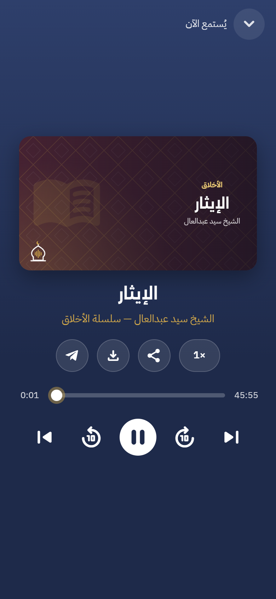
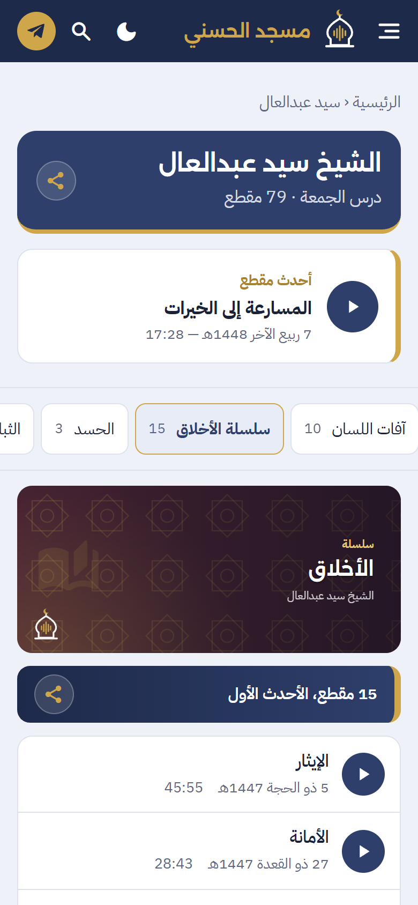

# Mosque Media

A free, self-hosted website for your mosque's **lessons, Friday sermons and Quran recitations**, built automatically from your public **Telegram channel**.

Visitors browse by sheikh → series → lesson and listen right on the site, with no Telegram needed. It costs nothing to run: the site is hosted on **Vercel** and the audio is stored in **GitHub Releases**.

🌍 **Available in 5 languages:** العربية · English · اردو · हिन्दी · Русский. Pick one or several in `site.config.json` and visitors switch between them from the top bar, with right-to-left and left-to-right layouts handled automatically. ([details](#languages))

<p align="center">
  
  
</p>
<p align="center"><sub>Live example: <a href="https://masjed-alhasany.vercel.app">masjed-alhasany.vercel.app</a>, the site this project grew out of.</sub></p>

---

## 🤖 Set it up with AI (recommended)

You don't need to be a programmer. Give this repository to an AI coding assistant that runs on your computer, such as [Claude Code](https://claude.com/claude-code), and it will handle the setup while you answer questions and approve each step.

Open the assistant in an empty folder and paste:

```text
Set up a website for my mosque using https://github.com/buggYateer/mosque-media
Clone it, read AGENTS.md, and walk me through the setup step by step.
Ask me about the look I want, and ask before anything that publishes or uploads.
```

Or in Arabic:

```text
عايز أعمل موقع لمسجدي من https://github.com/buggYateer/mosque-media
نزّله واقرأ AGENTS.md وامشي معايا خطوة خطوة. اسألني عن الشكل اللي عايزه، واستأذني قبل أي رفع أو نشر.
```

The assistant follows [AGENTS.md](AGENTS.md). It checks your tools, asks about your mosque and its visual identity, imports your channel, previews the site locally, and then helps you publish to GitHub and Vercel.

> 🔒 **Never paste tokens or passwords into the chat.** The assistant will tell you where to put them yourself.

---

## Features

- **Browse by sheikh, series and type.** Lessons, Friday sermons, recitations, latest uploads, most listened, and search.
- **Built-in player.** Remembers where you stopped, offers playback speed, plays the next lesson automatically, and works from the lock screen. Downloads save with the Arabic lesson title.
- **Automatic collections.** For example, every clip that mentions «رمضان» is grouped into *Ramadan Nights*.
- **Admin dashboard (`/lawha`), password-protected.** Rename, re-assign, hide or add clips and pick featured lessons from your phone.
- **Installable app (PWA)** with dark mode, offline support and a fast mobile-first design.
- **5 languages built in.** Arabic, English, Urdu, Hindi and Russian, each with its own address (`/en`, `/ur`…) and a language switch in the top bar. Adding another language is one translation file.
- **Your choice of storage.** JSON files in the repo (free, default), or PostgreSQL / Supabase / Neon / SQLite / Turso. Audio on GitHub Releases (free, default) or any S3-compatible bucket such as Cloudflare R2.
- **Your own identity and your own way.** Your logo, colors, font, corner style and header style are set with a short questionnaire. Dates (hijri, gregorian or both), content types, the title before a speaker's name, home sections and any wording can all be changed ([details](#customize-everything)).
- **Fast.** Every page is prerendered at build time; each recording has its own shareable page with a proper title and preview image.

<p align="center">
  
</p>
<p align="center">
  
  
  
</p>

## Make it yours

Every mosque gets its own look. Run the questionnaire:

```bash
python tools/setup.py
```

It asks for the mosque name, channel, colors, font, corners, header style and sheikhs. Then put your logo in `assets/logo.png` or `assets/logo.svg`; the app icons and share image are generated from it. The repository ships with a plain, neutral starter design that you then style your own way.

> **About the screenshots:** they show [masjed-alhasany.vercel.app](https://masjed-alhasany.vercel.app). Its visual identity is **not** included in this repository and may not be copied. That covers its name, logo, colors, fonts, covers and page design. The setup rejects its palette and fonts. Build a look that represents your own mosque.

## How it works

```
Telegram channel ──export / bot──▶ data/messages.json + data/audio/        (Python tools)
                                        │
                        tools/build_data.py
                                        ▼
                          content/lessons.json ──git push──▶ Vercel builds the Next.js site
data/audio/*.mp3 ──tools/update_site.py──▶ GitHub Releases or S3/R2 (audio)
Dashboard (/lawha) ──▶ content/overrides.json in GitHub  (or the database, if you chose one)
```

- **Titles** come from the first line of each post's caption (the text after `|` if present).
- **Sheikhs** are matched by name or nickname from `site.config.json`.
- **Type** (lesson / sermon / recitation) is detected from keywords you control.
- **Series** are defined in `data/series.json`, either by keyword or by message IDs.

## Manual setup

<details>
<summary><b>Requirements</b></summary>

- A **public** Telegram channel (with a username)
- Free [GitHub](https://github.com/signup) and [Vercel](https://vercel.com/signup) accounts
- [Python 3.10+](https://www.python.org/downloads/), [Git](https://git-scm.com/downloads), [GitHub CLI](https://cli.github.com), [Telegram Desktop](https://desktop.telegram.org)
- [Node.js 22+](https://nodejs.org) and pnpm (`npm install -g pnpm`)
- Optional: ffmpeg (to convert non-MP3 audio)
</details>

1. **Preview the demo.** Run `pnpm install`, then `pnpm dev`, and open http://localhost:3000.
2. **Configure.** Run `python tools/setup.py` (or edit `site.config.json` directly) and add your logo to `assets/`. The site reloads with your colors, font and languages.
3. **Import your channel.** In Telegram Desktop, open the channel → ⋮ → *Export chat history* → Audio files, JSON. Then run:
   ```bash
   python tools/import_telegram_export.py "path/to/ChatExport_folder"
   ```
4. **Define series** *(optional)* in `data/series.json`.
5. **Push to GitHub.** Create a public repo, put its name in `githubRepo`, then run `gh auth login`, `git init`, and push.
6. **Upload audio and publish.** Run `python tools/update_site.py`.
7. **Deploy on Vercel.** Import the repo; Vercel detects **Next.js** automatically. Deploy.
8. **Enable the dashboard.** In Vercel → Settings → Environment Variables, add:
   - `ADMIN_PASSWORD`: your dashboard password
   - `GITHUB_TOKEN`: a fine-grained token scoped to this repo with *Contents: Read and write*

   To upload audio from the dashboard, also connect a Blob store (Vercel → Storage → Create → Blob → Connect). It adds `BLOB_READ_WRITE_TOKEN` by itself. Then redeploy.

**Weekly update:** export only the new posts from Telegram, then run:

```bash
python tools/update_site.py --export "path/to/new/export"
```

A detailed, beginner-friendly guide in Arabic is in **[docs/guide-ar.md](docs/guide-ar.md)**.

## Customize everything

Nothing is forced on a mosque. All of this lives in `site.config.json` and has a default, so you only add what you want to change.

| Setting | What it does |
|---|---|
| `"dates": { "calendar": "both" }` | Dates in `hijri`, `gregorian`, `both`, or `none`. `hijriOffset` (−2…2) adjusts for local moon sighting. |
| `"types": [...]` | The content types. Rename the built-in ones (`lesson`, `khutba`, `tilawa`, `other`), drop some, or add your own with a `name`, `plural`, `icon` and the caption `words` that detect it. New types get a page at `/t/<key>`. |
| `"texts": { "ar": { "common.sheikh": "الأستاذ" } }` | Change any wording of the site, per language. Keys come from `messages/<language>.json`. |
| `"home": ["feature", "categories", "latest"]` | Which home sections show, and in what order. |
| `telegramChannel` | Optional. Without it, every Telegram button disappears. |

Run `python tools/apply_config.py` after a change; it points to the exact mistake if there is one. The Arabic guide has examples.

## Languages

| Language | Direction | Address | Status |
|---|---|---|---|
| العربية (Arabic) | right-to-left | `/` (default) | ✅ |
| English | left-to-right | `/en` | ✅ |
| اردو (Urdu) | right-to-left | `/ur` | beta |
| हिन्दी (Hindi) | left-to-right | `/hi` | beta |
| Русский (Russian) | left-to-right | `/ru` | beta |

Choose any of them, and which one is the default, in `site.config.json`:

```json
"i18n": { "default": "ar", "locales": ["ar", "en", "ur"] }
```

The default language has no URL prefix; others live under `/en/…`, `/ur/…`. Interface text is in `messages/<language>.json`, so adding a language means adding one file and listing it in `lib/config.ts`. Urdu, Hindi and Russian were machine-translated and are marked **beta** until a native speaker reviews them. Corrections are very welcome.

## Storage options

Pick them in `site.config.json` → `storage`. Connection secrets go **only** in environment variables.

| Data (`storage.data.provider`) | Needs |
|---|---|
| `github-json` *(default)* | Nothing. Files in `content/`, every change is a git commit |
| `postgres` | `DATABASE_URL` (PostgreSQL, Supabase, Neon, Vercel Postgres) |
| `sqlite` | `DATABASE_URL` (`libsql://…` for Turso, or `file:…`) and `DATABASE_AUTH_TOKEN` for Turso |

| Audio (`storage.audio`) | Needs |
|---|---|
| `{ "provider": "github-releases" }` *(default)* | Nothing |
| `{ "provider": "s3", "publicBase": "https://audio.example.com" }` | Upload keys `S3_ENDPOINT`, `S3_BUCKET`, `S3_ACCESS_KEY_ID`, `S3_SECRET_ACCESS_KEY` on your computer and as GitHub secrets |

With a database, run `pnpm data:sync` once (the weekly update does it automatically), and dashboard edits appear on the site within seconds without a redeploy. `pnpm data:export` copies everything back to `content/`.

## Project structure

| Path | Purpose |
|---|---|
| `site.config.json` | Everything about your mosque: name, channel, colors, design, languages, storage, sheikhs |
| `assets/` | Your logo (`logo.png` / `logo.svg`) |
| `app/` | Next.js pages (`[locale]/(site)/…`), the dashboard (`[locale]/lawha`), APIs (`api/…`), icons, manifest |
| `components/` | UI components (`ui/` = shadcn/ui) |
| `lib/` | Config validation, theme, data helpers, `storage/` providers |
| `messages/` | Interface translations, one file per language |
| `content/` | `lessons.json` (built by Python) and `overrides.json` (dashboard edits) |
| `data/` | Imported posts, series, upload log. Local audio in `data/audio/` is git-ignored |
| `tools/` | Python: `setup`, `import_telegram_export`, `fetch_bot`, `fetch_views`, `build_data`, `update_site` |
| `tests/`, `scripts/` | Playwright tests, storage contract tests, data sync |

## Development

```bash
pnpm dev            # local site at http://localhost:3000 (demo audio plays a short tone)
pnpm build          # production build (prerenders every page)
pnpm test           # storage tests + build + Playwright end-to-end tests
pnpm lint && pnpm typecheck
```

See [docs/plan-nextjs.md](docs/plan-nextjs.md) for the architecture and the parity checklist with the original site.

## Security

- Secrets never live in the repo. The dashboard password, GitHub token, database URL and storage keys are environment variables; the Telegram bot token goes in the git-ignored `data/bot_token.txt`. See `.env.example`.
- Signing in to the dashboard sets a signed, HttpOnly cookie. **The GitHub token never reaches the browser**; edits are saved through the site's own API.
- Audio uploads from the dashboard go straight from the browser to Vercel Blob with a short-lived permission, then a GitHub Action moves them to the audio store.
- The GitHub token should be **fine-grained and limited to this one repository**.

## Older version

The first version of this project (a plain HTML/JS site without Next.js) is kept on the [`v1`](https://github.com/buggYateer/mosque-media/tree/v1) branch.

## License

The code is released under the [MIT License](LICENSE).
